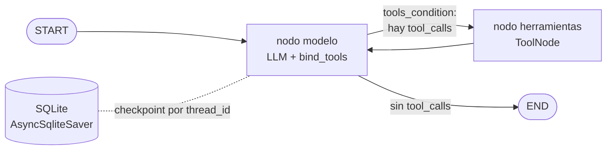

# Agente ReAct cíclico con memoria persistente (LangGraph)

Agente conversacional en **Python 3.12** que responde consultas sobre clientes y pedidos. Decide por sí mismo cuándo llamar a una herramienta, encadena varias llamadas cuando una respuesta depende de la anterior, se recupera de errores de las herramientas y recuerda la conversación entre ejecuciones gracias a un checkpointer en SQLite.

## Arquitectura



- **Estado:** `AgentState` hereda de `MessagesState` (lista de mensajes con reducer `add_messages`) y suma `llamadas_herramientas`, un contador acumulado con el reducer `operator.add`.
- **Ciclo ReAct:** el modelo razona, pide una herramienta, el `ToolNode` la ejecuta, el resultado vuelve al modelo y este decide si necesita otra herramienta o ya puede responder.
- **Persistencia:** cada paso se guarda en SQLite indexado por `thread_id`; con el mismo `thread_id` el agente retoma la conversación, incluso después de reiniciar el proceso.
- **Entorno asíncrono:** herramientas, nodos, runner y checkpointer usan `async/await`. Como el grafo se ejecuta con `astream`, se usa `AsyncSqliteSaver`, la variante asíncrona de `SqliteSaver` (mismo formato de base SQLite).

## Herramientas (base de datos simulada)

| Herramienta | Qué hace |
|---|---|
| `buscar_cliente(nombre)` | Busca clientes por nombre (sin tildes ni mayúsculas) y devuelve su `cliente_id` |
| `buscar_pedidos(cliente_id)` | Cantidad de pedidos, total gastado y lista de pedidos del cliente |
| `obtener_detalle_pedido(pedido_id)` | Productos, cantidades y precios de un pedido |

Cuando algo falla (cliente inexistente, pedido inexistente) devuelven un campo `error` con una `sugerencia` en lugar de lanzar una excepción, para que el agente pueda corregir el intento o pedir una aclaración.

## Estructura

```
├── agente/
│   ├── config.py        # variables de entorno validadas (Settings)
│   ├── database.py      # base de datos simulada y acceso asíncrono
│   ├── tools.py         # herramientas con @tool
│   ├── state.py         # AgentState (MessagesState + reducer)
│   ├── llm.py           # fábrica del LLM (OpenAI / Anthropic)
│   ├── graph.py         # StateGraph, prompt y recorte de contexto
│   ├── persistence.py   # checkpointer SQLite asíncrono
│   ├── runner.py        # ejecuta un turno con recursion_limit
│   ├── trace.py         # traza ReAct en JSON y texto
│   ├── offline.py       # modelo simulado para probar sin API key
│   ├── main.py          # chat / pregunta única
│   └── demo.py          # demo multi-paso que genera la traza
├── tests/               # 17 tests (sin llamadas a APIs)
├── trazas/ejemplo_traza.json
├── .env.example
└── requirements.txt
```

## Cómo levantar el entorno

Requisitos: Python 3.12+ y una API key de OpenAI o Anthropic.

```bash
git clone <URL-DEL-REPO>
cd agente_react
python3.12 -m venv venv
source venv/bin/activate          # Windows: venv\Scripts\activate
pip install -r requirements.txt

cp .env.example .env              # Windows: copy .env.example .env
```

Editá `.env`:

| Variable | Descripción |
|---|---|
| `LLM_PROVIDER` | `openai` (por defecto) o `anthropic` |
| `OPENAI_API_KEY` / `ANTHROPIC_API_KEY` | La clave del proveedor elegido |
| `LLM_MODEL` | Opcional. Por defecto `gpt-4o-mini` (OpenAI) o `claude-haiku-5-5` (Anthropic) |
| `RECURSION_LIMIT` | Máximo de pasos del grafo por turno (por defecto 10) |
| `DB_PATH` | Ruta de la base SQLite (por defecto `data/checkpoints.sqlite`) |

> `.env` está en `.gitignore`: nunca lo subas. Solo se versiona `.env.example`.

## Cómo ejecutarlo

**Demo multi-paso (genera la traza):**
```bash
python -m agente.demo
```
Hace 4 preguntas con el mismo `thread_id` y guarda la traza en `trazas/ejemplo_traza.json`:

1. *"¿Cuántos pedidos tuvo el cliente 102 y cuál fue el total?"* → 1 llamada.
2. *"¿Y qué productos tenía el último?"* → resuelve "el último" con la memoria del turno anterior.
3. *"Buscá a Martín Gómez y decime cuántos pedidos tuvo y qué contenía el más reciente."* → **3 llamadas encadenadas** (`buscar_cliente` → `buscar_pedidos` → `obtener_detalle_pedido`).
4. *"¿Cuántos pedidos tuvo el cliente 1020?"* → la herramienta devuelve un error y el agente pide aclaración.

Sin API key también se puede ver el flujo con un modelo simulado: `python -m agente.demo --offline`.

**Chat interactivo con memoria:**
```bash
python -m agente.main --thread-id cliente-102 --verbose
```
**Una sola pregunta (para probar la persistencia entre ejecuciones):**
```bash
python -m agente.main --thread-id prueba --pregunta "¿Cuántos pedidos tuvo el cliente 102?"
python -m agente.main --thread-id prueba --pregunta "¿Y qué compró en el último?"
```
La segunda ejecución es un proceso nuevo, pero recuerda la primera porque el historial está en SQLite. Con otro `--thread-id` la conversación empieza de cero.

## Traza de ejemplo

`trazas/ejemplo_traza.json` registra cada paso del ciclo ReAct: pregunta del usuario, decisión de herramienta (con argumentos), observación (resultado de la herramienta) y respuesta final. El campo `metadatos.origen_del_modelo` indica con qué modelo se generó. Para regenerarla con tu modelo: `python -m agente.demo`.

Fragmento (turno 3, razonamiento multi-paso):

```
Paso 10 | Acción -> buscar_cliente(nombre='Martín Gómez')
Paso 11 | Observación <- buscar_cliente: {"cantidad": 1, "coincidencias": [{"cliente_id": 205, ...}]}
Paso 12 | Acción -> buscar_pedidos(cliente_id=205)
Paso 13 | Observación <- buscar_pedidos: {"cantidad_pedidos": 2, "total": 18100, ...}
Paso 14 | Acción -> obtener_detalle_pedido(pedido_id='P-2002')
Paso 15 | Observación <- obtener_detalle_pedido: {"items": [...], "total": 11300}
Paso 16 | Respuesta: Martín Gómez (cliente 205) tuvo 2 pedidos por un total de $18.100. ...
```

## Buenas prácticas aplicadas

- **Autonomía real:** no hay `if/else` que enrute a herramientas; el LLM decide leyendo los docstrings. Los tests verifican que cada herramienta tenga una descripción detallada y cada argumento documentado.
- **Ciclo de retorno:** los errores de negocio vuelven al modelo como observación; los errores de validación de argumentos los captura el `ToolNode` y también vuelven al modelo, que puede reintentar.
- **Sin bucles infinitos:** `recursion_limit` se pasa en cada invocación (`RECURSION_LIMIT`, por defecto 10). Si se alcanza, el agente responde con un mensaje claro en vez de fallar.
- **Estado limpio:** antes de cada llamada al LLM se recorta el historial a los últimos mensajes (`recortar_mensajes`), sin tocar lo guardado en el checkpoint.
- **Tipado estático:** el código pasa `mypy --strict`; lint con `ruff`.
- **Secretos fuera del repo:** claves por variables de entorno, validadas al arrancar.

## Tests y calidad

```bash
pip install -r requirements-dev.txt
pytest -q
mypy agente
ruff check .
```
Los tests no consumen API: usan un modelo guionado (`ModeloGuionado`) para comprobar el grafo: razonamiento multi-paso, reducer del estado, memoria con el mismo `thread_id`, memoria tras reabrir la base, aislamiento entre threads, reintento tras error y corte por `recursion_limit`.

## Problemas frecuentes

- **`Error de configuración: Falta configurar OPENAI_API_KEY`**: la clave sigue con el valor de ejemplo.
- **El agente "olvida" todo**: cambiaste el `--thread-id` o el `DB_PATH` entre ejecuciones.
- **Mensaje de límite de pasos**: el agente superó `RECURSION_LIMIT`; subilo o reformulá la pregunta.
